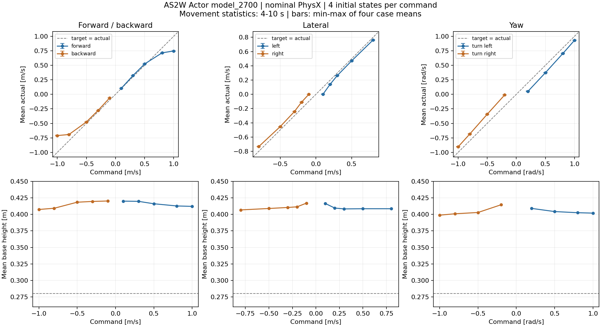

# AS2W 不同速度的 Actor 仿真验证

检查点：`model_2700.pt`，完成 2701 次更新；选择时间 2026-11-12T04:32:30.662539+08:00。原训练继续，未用后续权重替换本轮结果。

原生 Isaac Lab / PhysX，官方 AS2W 26 kg，腿 PD 40/1、轮 0/1，确定性 Actor 直接输出 12 腿角＋4 轮速。39 组命令 × 4 初始状态，共 156 个独立环境。每次 2 秒静止、8 秒运动、2 秒停车；4–10 秒统计运动，11–12 秒统计停车。

重复 0 是固定名义状态；其余三个为固定随机航向、根部 roll/pitch ±0.25°、腿角 ±0.005 rad。关闭观测噪声、动力学随机化和推扰，没有教师、StraightRoll、StopStance 或自动重置。这是短时平地测试，不代表真机或复杂地形能力。

结果：未触发跌倒阈值 **156/156**；姿态 **156/156**；停车 **156/156**；速度跟踪 **56/156**。所有非轮身体接触力记录峰值为 0 N；四轮接触计数在运动中有变化，传感器记录正常。

前后 0.3–0.8 m/s 的平均跟踪较好，1.0 m/s 命令明显欠速。低速纯横移 0.1 m/s 几乎没有响应，0.3–0.8 m/s 明显改善。转向低速偏弱，大角速度时平均值较接近，但存在非期望平移和瞬时速度波动。

| 命令 | 目标 vx / vy / wz | 实测均值 vx / vy / wz | 速度通过 | 运动平均高度 | 最坏倾角 |
|---|---|---|---:|---:|---:|
| 站立 | +0.00 / +0.00 / +0.00 | +0.000 / -0.000 / -0.002 | 4/4 | 41.9 cm | 0.4° |
| 前进 0.10 | +0.10 / +0.00 / +0.00 | +0.104 / -0.000 / +0.001 | 0/4 | 42.0 cm | 0.6° |
| 前进 0.30 | +0.30 / +0.00 / +0.00 | +0.323 / +0.000 / +0.001 | 4/4 | 42.0 cm | 0.9° |
| 前进 0.50 | +0.50 / +0.00 / +0.00 | +0.523 / +0.001 / +0.002 | 4/4 | 41.6 cm | 1.4° |
| 前进 0.80 | +0.80 / +0.00 / +0.00 | +0.714 / +0.002 / +0.015 | 4/4 | 41.3 cm | 2.0° |
| 前进 1.00 | +1.00 / +0.00 / +0.00 | +0.746 / +0.003 / +0.025 | 0/4 | 41.2 cm | 2.0° |
| 后退 0.10 | -0.10 / +0.00 / +0.00 | -0.061 / +0.001 / +0.000 | 0/4 | 42.0 cm | 0.6° |
| 后退 0.30 | -0.30 / +0.00 / +0.00 | -0.278 / -0.000 / +0.000 | 4/4 | 42.0 cm | 0.7° |
| 后退 0.50 | -0.50 / +0.00 / +0.00 | -0.476 / +0.001 / -0.000 | 4/4 | 41.8 cm | 1.1° |
| 后退 0.80 | -0.80 / +0.00 / +0.00 | -0.692 / +0.001 / +0.011 | 4/4 | 40.9 cm | 1.2° |
| 后退 1.00 | -1.00 / +0.00 / +0.00 | -0.710 / +0.006 / +0.009 | 0/4 | 40.7 cm | 1.7° |
| 左横移 0.10 | +0.00 / +0.10 / +0.00 | +0.004 / +0.003 / +0.003 | 0/4 | 41.7 cm | 1.2° |
| 左横移 0.20 | +0.00 / +0.20 / +0.00 | +0.019 / +0.142 / +0.011 | 0/4 | 41.0 cm | 1.7° |
| 左横移 0.30 | +0.00 / +0.30 / +0.00 | +0.007 / +0.264 / +0.005 | 4/4 | 40.8 cm | 2.3° |
| 左横移 0.50 | +0.00 / +0.50 / +0.00 | +0.008 / +0.470 / -0.008 | 4/4 | 40.9 cm | 2.4° |
| 左横移 0.80 | +0.00 / +0.80 / +0.00 | +0.023 / +0.762 / -0.019 | 4/4 | 40.9 cm | 3.3° |
| 右横移 0.10 | +0.00 / -0.10 / +0.00 | +0.000 / -0.001 / -0.006 | 0/4 | 41.7 cm | 0.4° |
| 右横移 0.20 | +0.00 / -0.20 / +0.00 | +0.016 / -0.109 / +0.013 | 0/4 | 41.1 cm | 2.2° |
| 右横移 0.30 | +0.00 / -0.30 / +0.00 | +0.013 / -0.241 / +0.011 | 1/4 | 41.0 cm | 2.0° |
| 右横移 0.50 | +0.00 / -0.50 / +0.00 | +0.022 / -0.453 / +0.015 | 4/4 | 40.9 cm | 2.8° |
| 右横移 0.80 | +0.00 / -0.80 / +0.00 | +0.023 / -0.733 / +0.008 | 4/4 | 40.7 cm | 4.3° |
| 左转 0.20 | +0.00 / +0.00 / +0.20 | +0.027 / +0.006 / +0.052 | 0/4 | 40.9 cm | 2.5° |
| 左转 0.50 | +0.00 / +0.00 / +0.50 | +0.028 / +0.026 / +0.372 | 0/4 | 40.4 cm | 3.1° |
| 左转 0.80 | +0.00 / +0.00 / +0.80 | +0.035 / +0.003 / +0.703 | 0/4 | 40.3 cm | 2.7° |
| 左转 1.00 | +0.00 / +0.00 / +1.00 | +0.041 / -0.021 / +0.931 | 0/4 | 40.2 cm | 2.6° |
| 右转 0.20 | +0.00 / +0.00 / -0.20 | +0.005 / +0.001 / -0.011 | 0/4 | 41.5 cm | 0.7° |
| 右转 0.50 | +0.00 / +0.00 / -0.50 | +0.045 / +0.045 / -0.343 | 0/4 | 40.3 cm | 2.5° |
| 右转 0.80 | +0.00 / +0.00 / -0.80 | +0.046 / +0.079 / -0.684 | 0/4 | 40.1 cm | 2.5° |
| 右转 1.00 | +0.00 / +0.00 / -1.00 | +0.033 / +0.080 / -0.905 | 0/4 | 39.9 cm | 2.7° |
| 左弧线 0.30 | +0.30 / +0.00 / +0.30 | +0.342 / +0.013 / +0.157 | 0/4 | 40.5 cm | 2.7° |
| 左弧线 0.50 | +0.50 / +0.00 / +0.50 | +0.486 / +0.037 / +0.427 | 1/4 | 40.8 cm | 2.5° |
| 左弧线 0.80 | +0.80 / +0.00 / +0.80 | +0.613 / +0.071 / +0.763 | 0/4 | 40.7 cm | 3.0° |
| 右弧线 0.30 | +0.30 / +0.00 / -0.30 | +0.312 / +0.007 / -0.149 | 0/4 | 40.5 cm | 1.9° |
| 右弧线 0.50 | +0.50 / +0.00 / -0.50 | +0.455 / +0.001 / -0.388 | 0/4 | 40.5 cm | 2.3° |
| 右弧线 0.80 | +0.80 / +0.00 / -0.80 | +0.599 / -0.070 / -0.745 | 0/4 | 40.3 cm | 2.6° |
| 左斜行 0.30/0.20 | +0.30 / +0.20 / +0.00 | +0.299 / +0.148 / +0.024 | 0/4 | 41.1 cm | 2.8° |
| 左斜行 0.50/0.30 | +0.50 / +0.30 / +0.00 | +0.494 / +0.276 / +0.008 | 4/4 | 41.2 cm | 4.7° |
| 右斜行 0.30/0.20 | +0.30 / -0.20 / +0.00 | +0.310 / -0.123 / +0.013 | 0/4 | 41.4 cm | 2.5° |
| 右斜行 0.50/0.30 | +0.50 / -0.30 / +0.00 | +0.492 / -0.251 / +0.006 | 2/4 | 41.3 cm | 3.3° |

速度均为机体系，平移单位 m/s，角速度单位 rad/s。表中均值不能代替时序误差：例如前进 0.1 m/s 的均值为 0.104，但名义回放的 vx 标准差约 0.040 m/s，MAE 约 0.032 m/s，略高于预设 0.030 门槛。原地转向还检查零平移轴的 MAE，不能只看平均角速度。

姿态检查只覆盖机身高度和倾角；沿用参考配置的自身碰撞关闭设置，未验证腿部自碰撞或真机安全性。

## 预先定义的验收条件

- **fall**：any height <.20 m or tilt >60 deg over entire rollout
- **velocity**：per-axis MAE <=max(.03 m/s,20% command) for commanded translation; <=.05 m/s on zero translation axes; yaw <=max(.05 rad/s,20% command), zero-yaw <=.10 rad/s; no fall
- **stop**：last-second mean horizontal speed <=.1 m/s and mean absolute yaw rate <=.15 rad/s; no fall
- **posture**：moving steady-window height >=.28 m and tilt <=25 deg
- **contact**：all-rollout peak nonwheel net contact force <50 N, using a full four-physics-step sensor history

这些是独立验证门槛，不是新增训练奖励。完整逐案例指标见 [cases.csv](evaluation/cases.csv) 和 [summary.json](evaluation/summary.json)。

## 低速指令覆盖线索

固定参考源码 `UniformThresholdVelocityCommand._resample_command()` 会把 XY 合速度不超过 0.2 m/s 的采样指令清零。因此小于该范围的纯平移并未作为非零指令正常覆盖。低速横移死区与此一致；这不能独自确定转向偏差的全部成因。当前训练配方未改。

## 录像

均选预先固定的名义重复 0，未筛选成功样本。画面来自保存的原生 PhysX 根部／关节轨迹，MuJoCo 只做正运动学和离线绘制，未运行新的 MuJoCo 动力学。

- [前后五档速度](video/forward_backward_labeled.mp4)：上排前进、下排后退，列为 0.1 / 0.3 / 0.5 / 0.8 / 1.0 m/s。
- [横移与转向](video/lateral_and_turning_labeled.mp4)：上排向左、下排向右；前三列横移 0.1 / 0.3 / 0.8 m/s，后两列转向 0.2 / 1.0 rad/s。

模型、原始轨迹、导出等价性、GPU 隔离及视频源哈希均随目录保存。
