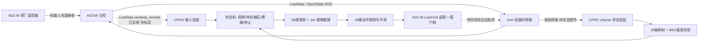

# AS2-W × CPRO 部署架构与落地顺序

更新：2026-11-09。本文回答“最后的工程如何像 GO2 那样持续运行、切换翻正和盲爬楼”。实机已验证 CPRO Ubuntu 构建、DDS 只读状态、原厂高层起立和遥控器接管；当前交付仍处于**模型核心 + 平台只读适配**阶段，真机低层控制器尚不存在。不要把目录中的策略目录文件误认成已运行的 FSM。现场状态见 `../../../部署测试/04_调试记录/INDEX.md`。

GO2 upstream `deploy/` 的逐组文件用途和移植判断见 [`go2_deploy_audit.md`](go2_deploy_audit.md)。

## 1. 最终系统与 GO2 工程的对应关系



推理始终在 **CPRO 的 Ubuntu 环境**；Orin 拓展坞仅是接入路径。个人 PC 用于准备文件、HDC/SSH 和日志查看，不参与最终闭环。原厂遥控器直接与机器人配对；策略程序将来只读它的 DDS 按键作为人工请求与停止输入，不能假设退出原厂运控后该话题或急停仍可用。

| GO2 模块 | AS2-W 对应 | 当前状态 |
| --- | --- | --- |
| `deploy/robots/go2/config/config.yaml`：FSM + `policy_dir` | `deploy/robots/as2w/config/config.yaml`：目前只有六份模型目录；未来需加真正的状态/转换配置 | 模型选择已实现，FSM 未实现 |
| `deploy/include/FSM/*`：状态机 | AS2-W 专属 FSM：观察、低层就绪、翻正、爬楼、停止/故障与交还运控 | 尚未实现 |
| `State_RLBase` + `OrtRunner` | `src/policy.cpp` 的 58→16 `.bin` MLP 和 `Controller` | 离线验证通过；非 ONNX |
| Go2 `LowState_t`/`LowCmd_t` | `unitree_hg` LowState/LowCmd，16 个实体轴、35 个消息槽 | 只读订阅与内存预演；未发布 |
| Go2 `unitree_joystick_dsl.hpp` | 原厂遥控器输入适配，当前候选是 HG `LowState.wireless_remote` | 独立 `rt/wirelesscontroller` 实收 0 包；嵌入字段有数据，键轴待标定 |
| GO2 工作站 WiFi/UDP 手柄脚本 | CPRO 本地推理、有线 DDS；原厂遥控器优先 | Windows 传包/现场阶段脚本已写 |
| `FixStand`/`Passive` | AS2-W 经验证的低层姿态过渡/阻尼/交还运控 | 不能沿用 GO2 的 12 轴姿态或“零命令=安全”假设 |

## 2. 当前工程树与真实职责

```text
cpp_deploy-as2w/
  CMakeLists.txt                    统一构建：策略核心、离线验证、SDK2 诊断
  src/policy.hpp + policy.cpp       同事交付：58维观测、16维动作、限制、映射、Controller
  src/main.cpp                      离线模型流/60帧夹具验证入口
  src/controller_test.cpp           策略核心边界测试
  deploy/robots/as2w/
    config/config.yaml              六份交付模型的名字与文件路径；不是运行中的 FSM
    src/diagnostics.cpp             DDS 状态、遥控器、官方高层动作、只读影子推理
    src/sport_gamepad.cpp           可选 CPRO USB Xbox 高层控制备选
  models/                            三份翻正 + 三份盲爬楼 .bin/.onnx/.fixture/manifest
  config/calibrated.map.example      训练轴 → 真机 DDS 槽位；仍为 UNVERIFIED
  config/hardware_contract.md        实机固件/控制权/轮速/急停合同
  tools/field.sh                     分阶段入口及原始日志
  tools/policy_select.py             按目录选择离线/只读影子模型
  docs/architecture.md               本文件；模块、门槛、落地顺序
```

目前 `diagnostics.cpp` 集中放了多个 SDK2 诊断子命令，后续应拆为 `RobotStateSource`（DDS 只读）、`RemoteInput`、`SportService`、`LowCmdSink` 和运行入口。`LowCmdSink` 现在**不创建也不发布**；拿到现场合同后才实现。目录结构已经将**可跨设备复用的策略核心**与**AS2-W 平台层**分开，避免在策略推理中硬编码 DDS 槽位。

## 3. 最终单进程控制器应如何工作

1. 启动前验证 CPRO 网卡、DDS、模型文件/哈希、16 轴映射、IMU 方向、线速度源、当前运控模式和急停途径。任一关键项未知则停在只读阶段。
2. 持续接收最新 LowState 与原厂遥控器输入；检查收包时间、有限值、实际 16 轴索引和模式。状态快照与控制周期解耦，丢包立即转故障处理。
3. FSM 初始为**观察**。只有场地、姿态、机器人模式、人工使能和退出路径全部满足，才能申请低层控制。状态不应只凭按键跳转。
4. 进入翻正或爬楼状态时选对应权重，重置上一帧动作与计时器。翻正必须提供训练所需的机体系线速度；爬楼不从摇杆直接改写训练观测里的固定命令。两种技能不能靠更换 `.bin` 在运行中无过渡切换。
5. 每 20 ms：状态适配 → 58 维观测 → 模型推理 → 16 维目标 → 关节/轮速限制 → AS2-W 专属 LowCmd 编码、CRC 和发送。**50 Hz 来自这批策略的训练/推理周期；LowCmd 实际发送频率须再与固件合同核对**，不能直接套 GO2 的 500 Hz。
6. 超时、姿态异常、遥控器停止或技能完成时，执行现场验证过的保持/阻尼/交还运控链。`Controller::step()` 返回空命令不是物理制动，`SportClient::StopMove()` 也不是低层电机失能。

推荐未来 FSM 名称是 `Observe → LowLevelReady → Recovery | Stairs → HoldOrDamp → RestoreSport`，旁路 `Fault`。这些是**设计目标，不是现有可运行的状态**。对应文件届时放在 `deploy/robots/as2w/src/` 和 `deploy/robots/as2w/config/`；先建立硬件合同和命令适配，再接 FSM，避免把 GO2 的 `Passive/FixStand` 数值拿来填空。

## 4. 从现在到实机策略的实现与测试顺序

| 阶段 | 工程产出 | 在 CPRO/AS2-W 上的验收 | 是否允许发低层电机命令 |
| --- | --- | --- | --- |
| A 已完成 | 交付模型、离线推理、配置目录、打包和日志入口 | 六份权重 60 帧夹具；CPRO 上重跑 | 否 |
| B 已写待实测 | DDS 状态/遥控器订阅、Sport 高层诊断 | 网卡/多播/PC1 连通、收包、原厂遥控器、高层站立/停止 | 否 |
| C 部分已写 | 16 轴校准、IMU 校验、只读影子推理 | 爬楼三份权重分别观察目标；恢复的机体系速度源另行验证 | 否 |
| D 待实现 | `LowCmdSink`、模式/CRC/轮速编码、看门狗、运动服务交接 | 先用硬件合同和隔离测试核对语义，再做受控低幅值验证 | 只有审核后 |
| E 待实现 | AS2-W FSM、模型状态、遥控器按键映射、退出过渡 | 平地验证使能/停止/故障，再验证翻正；最后到楼梯场地 | 是 |
| F 待实现 | 单入口启动/清理、性能与运行日志 | 重复启动、超时/断网/退出和恢复原厂运控 | 是 |

现场第 0–5 阶段的具体命令在 `部署测试/02_现场操作/现场部署清单.md`。从 C 到 D 的门槛由 `config/hardware_contract.md` 逐项记录；不能为了得到一个可执行文件而填猜测值。

## 5. 旧改造指南中的有效模式与已失效前提

`AS2-W_部署改造指南_from_Go2_v0.6.6.md` 是模型细节未知时写的迁移研究，不是当前机器的硬件合同。它对“设备层隔离、FSM、预检、日志、退出清理、策略配置驱动”的方法有价值；以下具体假设已由新资料或交付模型推翻：

- **12 DOF**：那是标准 AS2；AS2-W 是 12 条腿轴加 4 个轮轴，共 16 个训练动作。HG 的 35 是消息槽容量。
- **GO2 的 12 轴 joint map、FixStand 姿态、PD 增益、Passive 值**：不能沿用；必须按 AS2-W 训练轴顺序与实机合同建立。
- **ONNX Runtime + Orin/Jetson 优化**：本交付已有无需 ORT 的 C++ `.bin` 推理，目标 CPU 是 CPRO Ubuntu。`.onnx` 留作交叉校验，不是当前部署依赖。
- **工作站 Xbox→WiFi→Orin 推理**：本项目是 CPRO 推理，经有线链路访问 AS2-W；优先原厂遥控器，不要求工作站手柄流。
- **复制 GO2 `LowCmd` 结构与 500 Hz 循环**：IDL 家族、轮轴语义、实际固件频率都不同或未知。官方 AS2 的 12 轴表也不能补出 AS2-W 四轮槽位。

因此借鉴 GO2 的**工程分层和阶段门槛**，不直接 fork 它的 12 轴执行代码。当前可复用的模型核心来自同事 Rob2Nav 交付，适配层按 AS2-W 实机证据逐步补齐。
